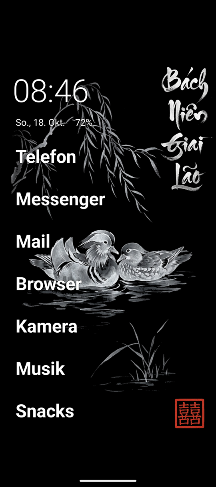
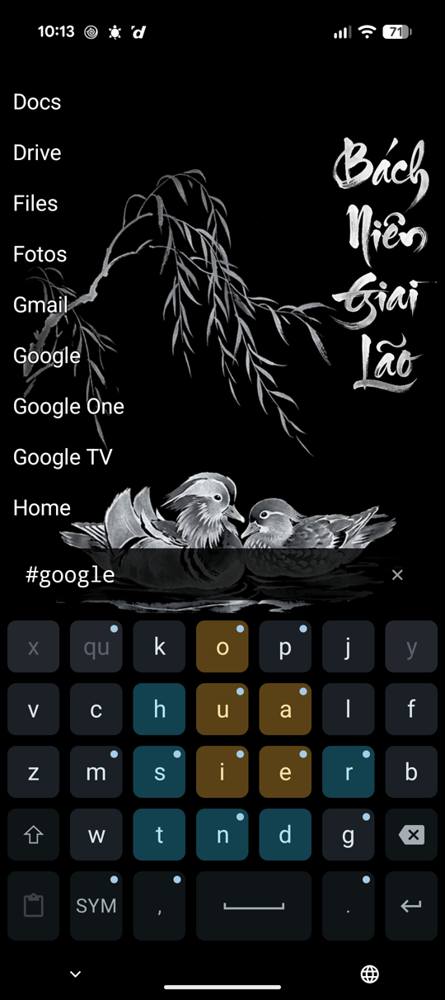
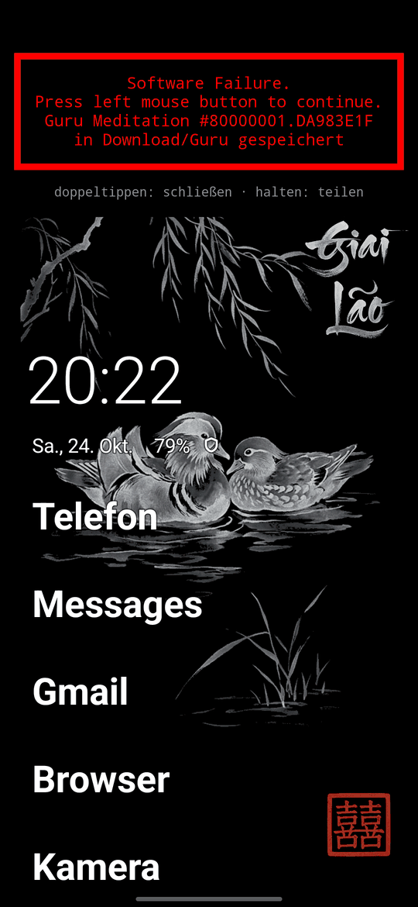

# Verso Launcher

A **plain text launcher for Android with a hidden command line** — the child of Kolibri
Launcher and Sigil Launcher. Neither is maintained any more; **Verso is the official
successor of both.** Kolibri gives it the quiet home screen. Sigil was a terminal: one
prompt, keyboard always up. Verso keeps that whole command line but moves it behind a
page turn, so the front looks like an ordinary minimal text launcher.

The name is the idea: a sheet of paper has a **recto** (the front) and a **verso** (the
back). The front is your home screen; swipe up and you turn the page to the back, where
every app and every sigil command lives.

<p>
  
  &nbsp;
  
</p>

## The two pages

**Front (home)** — Kolibri Launcher's home layout, with Kolibri's default settings, no
keyboard, no prompt:

- The clock (60dp, light) and below it the short date and the battery level, with a
  bolt while charging and a shield while battery protection holds the charge. **Double
  tap** the clock for your alarms, the date for your calendar, the battery for battery
  usage — a single stray touch does nothing, as in Kolibri.
- Your favorites in large bold text, in your own order, top to bottom. Tap to launch,
  long-press for the rename/tags dialog (with *App info*). More favorites than fit
  simply scroll. Home text sizes are fixed (dp): they do not follow the system font size.
- All home text (and the two icons) carries Kolibri's thin tonal outline, so it stays
  readable on any wallpaper without darkening it.
- First start: Verso picks your default phone, messenger (default SMS app), email,
  browser and camera as starting favorites. Only once — remove them and they stay gone.
- No favorites yet? A short hint says how to add them (tap it to open the drawer).
- Text follows the wallpaper: white with a dark outline on a dark wallpaper, black with
  a light outline on a light one (the drawer and the status-bar icons too), switching
  by itself when you change the wallpaper.
- **Pull up** → the drawer comes up with your finger; let go past about a quarter of
  the screen (or flick) and it opens, otherwise it drops back. **Pull down** → your
  recently used apps come down from the top like a HUD, the same way with your finger
  (the drawer on its `?` view, without the keyboard); **pull up** to put them away, or
  Back, which goes straight home. Clear the `?` (×, or type) and it is the plain drawer
  again, closed with a pull down. A pull down that starts at the very top edge is left to
  the notification shade. A second finger cancels a pull.
- With a hardware keyboard, just type: the drawer opens with what you typed in the
  command line (the Search key opens it empty).

**Back (drawer)** — the original Sigil Launcher:

- Opens on **every app, A to Z**, with the command line at the bottom and the
  keyboard up. **Enter** on the empty line just drops the keyboard so you can scroll
  the whole list.
- Type to search; results gather right above the command line and **Enter** launches
  the nearest one.
- **Pull down** with the list at its top — the drawer follows your finger, back and
  forth, and closes past about a quarter of the screen or on a flick (a list that can
  still scroll scrolls first, then hands over) — **Back** on an empty line, or **HOME**
  turns back to the front page. Back on a non-empty line first
  clears it (a bare `?` excepted: it goes straight home). With gesture navigation the
  back swipe previews the close — the drawer slides down a little with your thumb and
  drops back if you change your mind.
- Launching an app (or leaving the launcher any other way) always brings you back to
  the front page next time.

## The command line

- Lists launchable apps over your wallpaper in the favorites' colour — white on a dark one,
  black on a light one, with the same outline. The command line carries that outline too,
  right on the wallpaper.
- Lists the launchable apps of every profile through `LauncherApps` — your own plus
  a work profile or cloned apps, which carry the system's badge ("Calculator
  (Work)") and start in their own profile. Installs, uninstalls and updates show up
  at once, even while the launcher stays open.
- Apps that cannot start right away stay in the list, **dimmed**: those of a paused
  work profile, and archived apps (Android 15+, code removed, data kept). The first
  tap on a paused one turns its work apps back on — the row brightens and a toast
  says it is ready, so you choose whether to open it; an archived one offers the
  system's restore.
- The bottom command line drives everything; the leading character picks a mode:
  - *(empty)* — the full drawer, A to Z: everything except hidden apps, **but a
    favorite is always kept even when also hidden** (favoriting overrides hiding)
  - `text` — substring search across **all** apps (hidden included)
  - `*` — the same drawer, but with your favorites grouped nearest the command line
  - `*text` / `text*` — the drawer narrowed to apps whose name **starts with**
    `text` (unlike the star-less search, which matches anywhere in the name). The
    star counts on **either** side, so it does not matter whether you type it before
    or after the prefix — whichever side the cursor happens to leave it on
  - `#` — lists the tags in use; tap one (or **Enter** on the nearest) to drill into
    that tag's apps
  - `#text` — tag filter: the apps under every tag starting with `text` (so `#gam`
    finds your `games` apps). Tap or **Enter** to launch. Tags are assigned in the
    long-press dialog or in bulk with `##`; a tagged app shows here even when hidden.
    When no tag starts with `text`, the package names are searched instead, so `#google`,
    `#samsung` or `#reygnn` lists an app maker's apps without any tag set (any part of the
    package name after the first, `com.google.android.gm` for `#google` or `#android`)
  - `##` — edit tags in bulk: lists every tag you defined (also one whose apps are all
    uninstalled, so it can be reused), tap one and you get **every** app
    with an `[x]`/`[ ]` for that tag; tap a row to toggle it, saved immediately. This
    is the way to put one tag on many apps — the long-press dialog stays the way to
    invent a tag and to set several tags on one app
  - Tag names are canonicalised wherever they are entered: lowercased, trimmed, and
    `#` and `,` are dropped. `#` because the tag list builds its prompt by prepending
    a sigil (a tag starting with `#` would turn `#tag` into `##tag`, a different mode);
    `,` because it separates tags in the long-press dialog. Typing `#work` gives you
    `work` rather than an error, and an older config is cleaned up as it loads
  - `-[text]` — edit hidden: tap a row to toggle `[x]`, saved immediately
  - `![text]` — edit favorites: tap a row to toggle `[x]`, saved immediately. The
    favorites are what the front page shows
  - `!!` — reorder favorites: tap a row to pick it up (marked `»`), tap another
    row to drop it there; tap the picked row again to cancel. Saved immediately, and
    the front page lists them in exactly this order, top to bottom
  - `?` — the last 8 launched apps still installed, newest nearest the command line. Kept in
    `recents.txt` beside the config — not in `verso.json` and not in a backup; lose it
    and the list starts over. **Enter** relaunches the most recent. `?text` narrows
    them like a search
  - `%` — **Enter** (or a tap on its row) switches the plain drawer between A to Z and
    **most used first**, and keeps it that way. Most used is Kolibri's decayed count:
    each launch from Verso counts, fading with time (a week old counts about half, a month
    old a tenth), so what you use now rises above what you used a lot once. Only the plain
    drawer is reordered; searches, tags and the edit modes stay as they are. The counts live
    in `usage.txt` beside the config — not in `verso.json` and not in a backup; lose it and
    counting starts over
  - `~[text]` — commands. Typing `~` lists the commands; typing more narrows the
    list (`~r` leaves `~restart`, `~restore` and `~restore-saf`). Tap a row to run it, or press
    **Enter** once what you typed can only mean one command — `~b` is enough for
    `~backup`. An ambiguous prefix does nothing on **Enter**, it just keeps the list
    up. Every change is saved the moment you make it, so there is no save or load
    command. Each command acts once and clears the prompt. One runs at a time: a second
    one sent meanwhile is refused with a toast and stays on the line, to send again, and
    so is any edit until it is done:
    - `~crash` — only in a daily-driver build (`./gradlew bundleRelease -PdailyDriver`, and
      every debug build): crash on purpose, to see Guru's report. Spelled out only — `~c` stays
      `~cleanup`
    - `~restart` — read the config again and rebuild the list (after editing
      `verso.json` by hand, or when something looks stale). It also retries
      `recents.txt` and `usage.txt` if they could not be read
    - `~backup` — export the config to `Download/Verso/`, named after the moment it
      was taken (`verso-2026-10-13_120745.json`). Every backup is a new file, and Verso
      never deletes one: a failed or interrupted backup leaves the older ones as they
      were. Clear out old ones with a file manager. An ordinary file: it survives an
      uninstall and can be copied off the device (that's how you move a config to
      another phone) — the only copy besides `verso.json` itself
    - `~restore` — adopt the newest of those backups again. No file picker. The
      config being replaced is first written next to it as
      `verso-pre-restore-<date>_<time>.json`; if that fails, the restore is
      aborted, so a restore never destroys what it overwrote without a trace. A
      backup that doesn't parse changes nothing. To undo a restore, run
      `~restore-saf` and pick that `verso-pre-restore-…` file. If `verso.json` itself
      can't be read when Verso starts, Verso starts empty, as an app does whose settings
      are lost; `~restore` brings your config back from the last `~backup`.
    - `~restore-saf` — the same, but you pick the file in the system document
      picker. Plain `~restore` only sees files this app itself wrote, so a config
      carried over from another phone (or surviving a reinstall) is invisible to
      it; this is the way in for those. No permission. Before anything changes, a dialog shows
      what the file sets — favorites, hidden apps, custom names, tag lists — and only its OK
      restores it (any file can be picked, also one another app put there). If a command is
      still running, the confirmed file waits and is restored right after; meanwhile `~restore`
      and `~restore-saf` say a file is still being restored, and everything else goes on. A
      `~restart` before then drops the pick (a toast says so)
    - `~cleanup` — remove what the config still keeps for apps that are no longer
      installed (their favorite slot, hidden mark, custom name and tags; kept on
      purpose until then, so a reinstalled app gets them back). A dialog shows how
      many entries of each kind it would remove and asks first; on OK it checks
      again, and the current config is saved as `verso-pre-cleanup-<date>_<time>.json`
      before anything goes. `~restore-saf` with that file undoes it — it brings back
      the whole config as it was then, so later changes go too; and the next
      `~cleanup` replaces that undo point (also one that removed nothing in the end). Only apps gone from the device count: a
      disabled app, one with its icon switched off, one on an unmounted card, a system
      app removed only for you, or one in a profile Verso cannot list (or that shows no
      apps right now) keeps its entries; an entry whose launcher activity an update
      renamed, or a malformed one from a restored file, counts as gone. Nothing runs
      unless every profile could be read. Don't run it while a new phone is still reinstalling
      your apps — those not back yet count as gone. Old files in `Download/Verso/`
      are left to a file manager (Android lets Verso touch only its own)
- Tap a row or press **Enter** to launch. **Enter** launches the row nearest the
  command line (the bottom-most, since results fill upward). On an empty line
  **Enter** only drops the keyboard (see above) — it never launches.
- A `×` clear button at the right end of the command line wipes the prompt back to
  the plain drawer in one tap, keeping the keyboard up so you can retype at once; it
  shows only while there is text to erase.
- Long-press any row to set a custom name and its tags (comma-separated).
- Registers as `HOME` + `LAUNCHER`, `singleTask` (package
  `com.github.reygnn.verso_launcher`, config in `verso.json`, backups in
  `Download/Verso/`).

## Lineage

The front page is a port of Kolibri Launcher's home
screen (`fragment_home.xml`, `HomeFavoritesAdapter`, `TextOutline`, the default layout
values) to plain platform widgets — no AndroidX, no RecyclerView. Kolibri's adjustable
settings (size, spacing, alignment, colours) are fixed at Kolibri's defaults; the numbers
live in `HomeStyle.kt`. Not ported: the alarm/calendar indicators next to the clock and
the double-tap events dialog (they need calendar permission), and the left/right swipe
actions.

Kolibri Launcher and Sigil Launcher are both discontinued, and Verso is the official
successor of both. It started as a copy of the Sigil 0.2.x line (favorites, hidden apps,
custom names, tags, `~` commands) with Kolibri's home screen as its front end. Everything the prompt can do
is unchanged except the empty line: in Sigil it showed your favorites, in Verso it
shows the full drawer, because the favorites now live on the front page.

## What was chopped

Inherited from Sigil, which drops **all** of Kolibri Launcher's stack:

- no Compose, no Material, **no AndroidX at all** — platform widgets only
- no Hilt / DI — a single `Activity` wires itself
- no Navigation / Fragments — one `Activity` (rename is a bare platform dialog)
- no DataStore / Room / SharedPreferences — the small amount of state (hidden
  apps, favorites, custom names, tags) is a single hand-rolled `verso.json` in
  `filesDir` (beside it only throwaway files: `home-cache.txt`, a copy of the favorites for an
  instant first frame, and `usage.txt` and `recents.txt` behind `%` and `?`; and Guru's crash
  reports in `guru/` until the next start saves them, see "Crash reports"), kept the way
  Android keeps SharedPreferences (the last complete file waits as `verso.json.bak` while a
  write is under way; a file that cannot be read loads as empty) — your own `~backup`s are the
  copies to fall back on; and edited only through the in-app modes above
- no ACRA / Timber — `android.util.Log`; crash reports come from Guru, vendored as source
  (no library, no permission, no network — see "Crash reports")
- no ViewBinding / XML layouts — UI built in code

The launcher is a handful of small files. `MainActivity.kt` is the framework wiring
(commands, backup and restore, edits, dialogs, launching); everything beside it is either pure
and unit-tested on the JVM or a thin view class:

- `LauncherState.kt` — the data: config, app list and recents, plus the rules that keep
  them consistent when a background load overlaps a toggle, rename, reorder or restore
  (see the class comment). Plain Kotlin taking its threads as functions —
  the role a ViewModel would play, without the AndroidX dependency.
  `LauncherStateTest` replays every overlap deterministically with two manual queues.
  `LauncherStateParts.kt` holds what it is built from: the process-wide `ProcessState`
  (recents, launches, two flags) and the three files it reads and writes.
- `PageTurn.kt` — the page turn between home and drawer: the drag that follows the finger,
  the settle, the Back preview and the status bar per page.
- `AppDrawer.kt` — the back page: list, command line and what the list shows for a prompt.
- `Apps.kt` — the apps on the device: enumeration of every profile, `~cleanup`'s "still
  there?", the default favorites; `Cleanup.kt` the pure decision what `~cleanup` may offer.
- `AppEntry.kt` — one app row (package/class as plain strings, so the state is testable).
- `LauncherLogic.kt` — mode parsing, filtering, favorite ordering and reordering, what
  Enter and a tap do.
- `TapGuard.kt` — the staleness check that keeps a click acting on the row it aimed at.
- `Guard.kt` — the backstop around every IO-thread task: an escaped exception is logged, not
  a crash on every start.
- `SwipeGesture.kt` + `SwipeFrame.kt` — the page-turn swipe: pure decisions and their
  thin touch wrapper.
- `HomePage.kt` — the front page (Kolibri's home layout); `HomeStyle.kt` holds its pure
  numbers, `OutlinedViews.kt` the outlined text/icon views, `WallpaperPalette.kt` the text
  colours for the wallpaper behind them (asked once, then kept current by the system's listener).
- `VersoConfig.kt`, `ConfigJson.kt`, `ConfigStore.kt`, `BackupStore.kt` — the config
  model, the `verso.json` round-trip, the durable file layer and the Downloads backup;
  `BackupFiles.kt` the backup naming rules,
  `RestoreSteps.kt` a restore's IO in its load-bearing order.
- `HomeCache.kt` — the favorites cached for an instant home page on a cold start;
  `UsageLog.kt` and `RecentsLog.kt` the `%` counts and the `?` list, disposable files too.
- `VersoApp.kt` — the process: the one IO thread and what outlives an activity
  (recents, palette, badge labels).
- `RenameDialog.kt` — the long-press dialog.
- `CommandGate.kt` — the `~` commands one at a time (pure, JVM-tested).
- `VersoGuruTexts.kt` — Guru's words (see "Crash reports").

## Crash reports

Verso carries [Guru](https://github.com/reygnn/guru), a crash reporter vendored as source in
`guru/` (a `git subtree`, never edited here). A crash is written to disk while the process
dies; at the next start, before the alert, Guru saves it without asking as a `.json` file in
`Download/Guru/` (MediaStore, no permission; Guru keeps its newest 32 there) and Verso shows
the Amiga alert saying so, a black strip at the top with Verso slid down beneath it until the
alert closes — unless the alert itself was what crashed: then the file is saved and the alert
left out. **Hold** hands the saved files to an app you pick (mail, a messenger,
guru2acra), **double-tap** or **Back** closes the alert; once seen it does not come again. To be
rid of a report, delete its file. Guru itself sends nothing; the files are readable by anything
that reads `Download` — see `CAVEATS.md`.

<p>
  
</p>

Guru adds about 30 KB of code and keeping class names (`-dontobfuscate`, for readable crash
traces) about 18 KB: the release APK went from about 180 to 231 KB. The only
*shipped* dependencies are the Kotlin stdlib (added automatically by AGP's
built-in Kotlin); JUnit, org.json and Robolectric are `testImplementation`,
androidx.test is `androidTestImplementation`, so the release stays dependency-free.

## Build

```bash
./gradlew bundleRelease   # unsigned release AAB (R8 full mode + resource shrink)
```

Stack matches the family baseline: AGP 9 built-in Kotlin, Gradle 9, JDK 21,
`minSdk = targetSdk = 36` (Android 16, no compat shims), `compileSdk = 37`.
